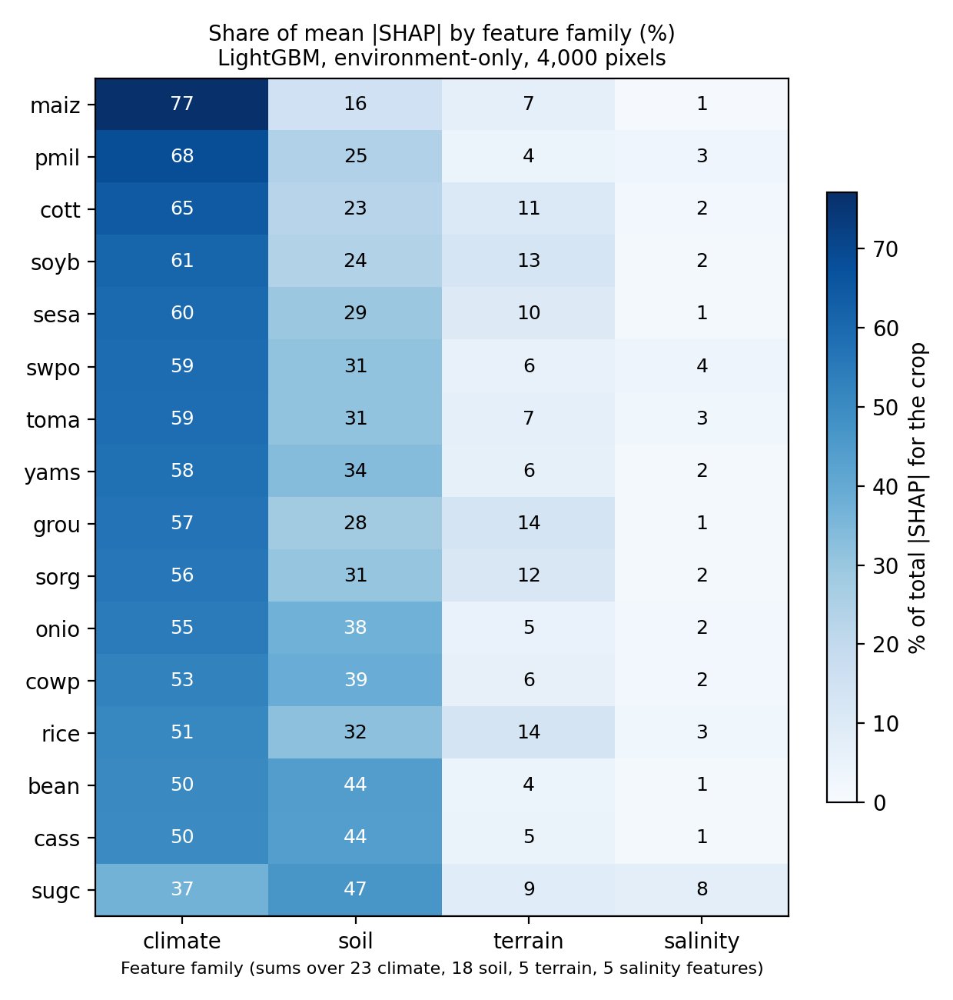
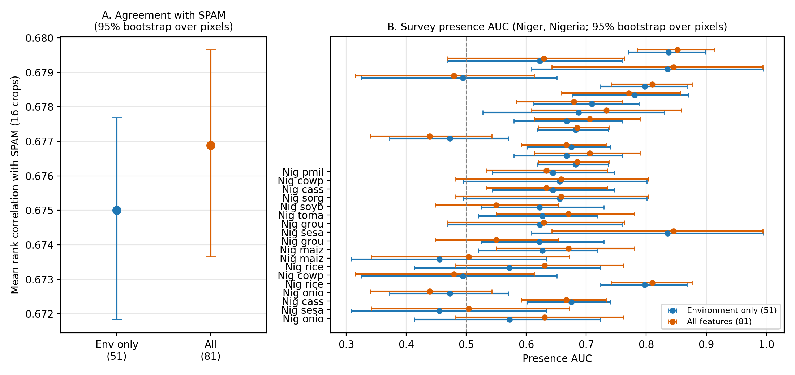
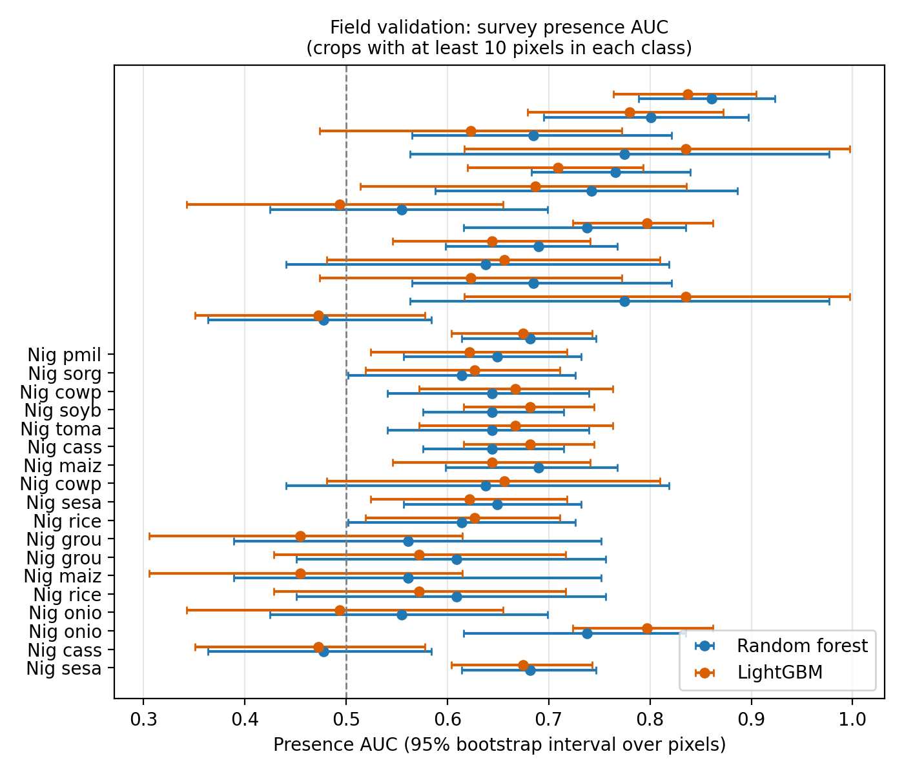
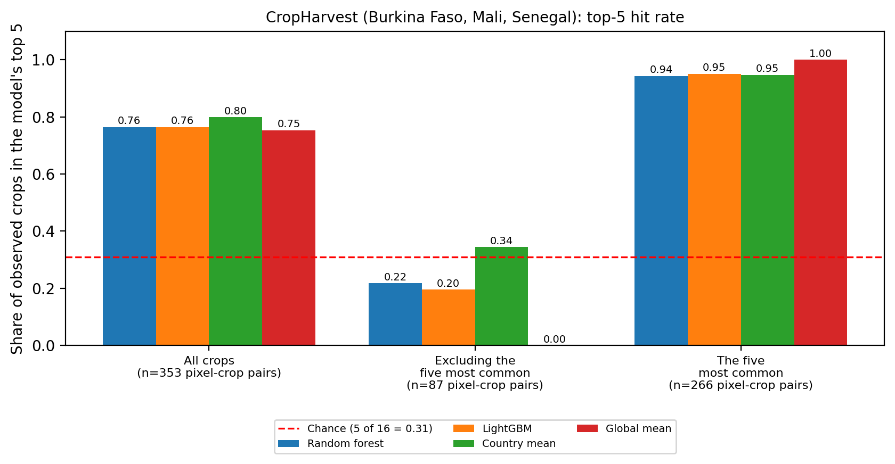

# Figures

All figures are released under CC BY-SA 4.0 because they derive from CC BY-SA 4.0 data.

*Figure 1.* (Share of mean |SHAP| by feature family, LightGBM environment-only models. Model trained on SPAM 2020 v2.2 harvested-area shares (IFPRI, 2025, doi:10.7910/DVN/SWPENT, CC BY-SA 4.0) with features from CHIRPS, TerraClimate, ERA5-Land, SoilGrids 2.0, SRTM and the Ivushkin et al. (2019) soil salinity maps. Contains modified Copernicus Climate Change Service information. Figure released under CC BY-SA 4.0.)
*Models trained on SPAM 2020 v2.2 (IFPRI, CC BY-SA 4.0); features from CHIRPS, TerraClimate, ERA5-Land, SoilGrids, SRTM and Ivushkin et al. (2019). Figure: CC BY-SA 4.0. Full credits: [docs/figures/README.md](docs/figures/README.md).*

*Figure 2.* (Environment-only vs all-feature LightGBM models: agreement with SPAM (panel A) and household-survey presence AUC (panel B). Contains data from SPAM 2020 v2.2 (IFPRI, 2025, CC BY-SA 4.0); Nigeria GHS-Panel 2018-2019 W4 (NBS, doi:10.48529/1HGW-DQ47) and Niger EHCVM 2018-2019 (INS, doi:10.48529/GGAM-AX39), World Bank Microdata Library; Sentinel-1/2 and MODIS features (Contains modified Copernicus Sentinel data 2019-2023; NASA LP DAAC). Figure released under CC BY-SA 4.0.)
*Data: SPAM 2020 v2.2 (IFPRI, CC BY-SA 4.0); Nigeria GHS-Panel 2018-19 and Niger EHCVM 2018-19 (World Bank Microdata Library); contains modified Copernicus Sentinel data (2019-2023). Figure: CC BY-SA 4.0. Full credits: [docs/figures/README.md](docs/figures/README.md).*

*Figure 3.* (Presence AUC of out-of-fold random forest and LightGBM predictions against household-survey crop observations, with 95% bootstrap intervals over SPAM pixels. Survey data: Nigeria GHS-Panel 2018-2019 W4 (NBS, doi:10.48529/1HGW-DQ47) and Niger EHCVM 2018-2019 (INS, doi:10.48529/GGAM-AX39), World Bank Microdata Library; only aggregate statistics are shown, no microdata. Models trained on SPAM 2020 v2.2 (IFPRI, 2025, CC BY-SA 4.0). Figure released under CC BY-SA 4.0.)
*Data: Nigeria GHS-Panel 2018-19 and Niger EHCVM 2018-19 (World Bank Microdata Library, aggregate statistics only); models trained on SPAM 2020 v2.2 (IFPRI, CC BY-SA 4.0). Figure: CC BY-SA 4.0. Full credits: [docs/figures/README.md](docs/figures/README.md).*

*Figure 4.* (Share of CropHarvest-observed crops that fall in the model's top 5 of 16 crops (chance 0.31), for Burkina Faso, Mali and Senegal. CropHarvest v14 (Tseng et al., 2023, doi:10.5281/zenodo.10251170, CC BY-SA 4.0; contributing datasets may carry additional terms). Models trained on SPAM 2020 v2.2 (IFPRI, 2025, CC BY-SA 4.0). Figure released under CC BY-SA 4.0.)
*Data: CropHarvest v14 (Tseng et al., 2023, CC BY-SA 4.0); models trained on SPAM 2020 v2.2 (IFPRI, CC BY-SA 4.0). Figure: CC BY-SA 4.0. Full credits: [docs/figures/README.md](docs/figures/README.md).*
